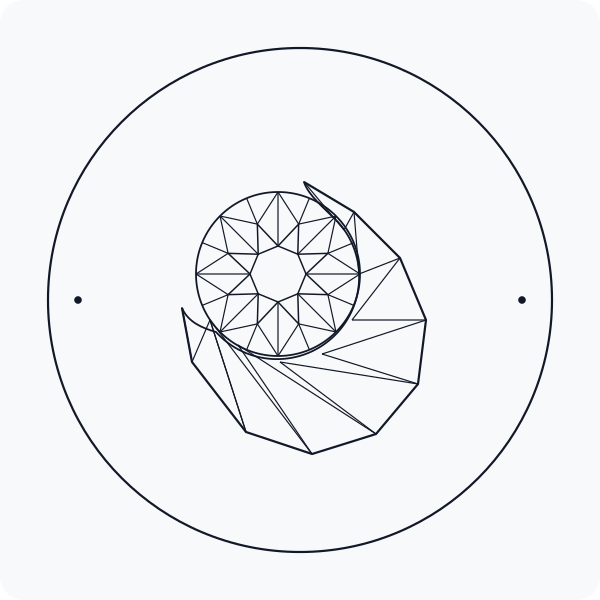

<p align="center">
  <picture>
    <source media="(prefers-color-scheme: light)" srcset="assets/eon-logo-dark.svg">
    
  </picture>
</p>

# Eon

**Eon** is a high-performance, multi-dimensional destiny intelligence platform and metaphysical calculation engine written in 100% native Rust. It synthesizes 8 ancient and modern metaphysical systems through rigorous systems engineering, reproducible rule engines, and deterministic calculations.

Engineered specifically for **Large Language Models (LLMs) and autonomous AI Agents**, Eon provides an ultra-fast native CLI (`eon`), formatted context prompt generators, and a stdio **Model Context Protocol (MCP)** server.

[](https://github.com/sjkim1127/Eon/actions/workflows/ci.yml)
[](Cargo.toml)

---

## Table of Contents

- [Key Capabilities](#key-capabilities)
- [Architecture](#architecture)
- [Workspace Crates](#workspace-crates)
- [Quick Start](#quick-start)
- [CLI Command Reference](#cli-command-reference)
- [AI Agent & LLM Integration](#ai-agent--llm-integration)
- [Model Context Protocol (MCP) Setup](#model-context-protocol-mcp-setup)
- [Rust SDK & Service Façade](#rust-sdk--service-façade)
- [Development & Verification](#development--verification)
- [Disclaimer & License](#disclaimer--license)

---

## Key Capabilities

- **8 Multi-Tradition Calculation Engines**:
  1. **Saju (Four Pillars of Destiny / BaZi)**: Stems, Branches, Hidden Stems, Strength diagnostics, Gyeokguk, Yongshin, Daewun (10-year luck), Shinsal, and Five Elements throughput.
  2. **Vedic Astrology (Jyotish)**: Sidereal planetary positions, Varga charts (D1..D60), Shadbala, Ashtakavarga, Vimshottari Dasha, Sade Sati, and 100+ classical Yogas.
  3. **Western Astrology**: Tropical positions, Placidus & Whole Sign houses, major and minor aspects, Arabian parts, and complex aspect patterns (Grand Trine, T-Square, Yod, etc.).
  4. **Zi Wei Dou Shu (Purple Star Astrology)**: 12 Palaces, 14 Major Stars, Flying SiHua (Mutagenic Stars), and classic destiny configurations.
  5. **Human Design System**: Type, Profile, Inner Authority, 9 Energy Centers, 36 Channels, and 64 Gates.
  6. **QiMen DunJia**: Yin/Yang Dun 18 Ju formations, 9 Palaces, 8 Doors, 9 Stars, and 8 Deities with Value Chief and Envoy Door tracking.
  7. **Pythagorean Numerology**: 5 Core Numbers (Life Path, Expression, Soul Urge, Personality, Birthday), 4 Pinnacle Cycles, and Personal Year vibrations.
  8. **Omni Destiny Tier 7.0 Synthesis**: Multi-engine quantum cross-synergy matrix scoring potential, resilience, growth gap, and 15 weighted component factors.
- **Ultra-Fast Native Performance**: Full 8-engine synthesis executes in **< 50 milliseconds**.
- **Agent-First Output Formats**:
  - `agent`: High-density markdown prompt context optimized for LLM reasoning.
  - `json`: Fully typed, structured JSON serialization of DTO contracts.
  - `markdown`: Clean human-readable reports with structured markdown tables.
  - `text`: Terminal summary view.
- **Native MCP Server**: Ready-to-use Model Context Protocol server over stdio for Claude Desktop, Cursor, Antigravity, and AI coding assistants.

---

## Architecture

Eon uses a modular Rust monorepo where all analysis engines feed into a single unified façade (`eon-service`) that serves the native CLI and MCP layer (`eon-cli`):

```text
eon-core (Shared Primitives, Birth Info, Locations)
  ├── eon-data (Calendar Data & Binary Manseryuk Cache)
  └── eon-astro (Pure-Rust Swiss Ephemeris Engine)
        │
        ├── eon-saju (Four Pillars of Destiny Engine)
        ├── eon-vedic (Vedic Astrology / Jyotish Engine)
        ├── eon-western (Western Astrology Engine)
        ├── eon-zwds (Zi Wei Dou Shu Engine)
        ├── eon-human-design (Human Design Engine)
        ├── eon-qimen (QiMen DunJia Engine)
        └── eon-numerology (Pythagorean Numerology Engine)
              │
              ▼
          eon-service (Unified Façade & Contract DTO Boundary)
              │
              ▼
          eon-cli (Native CLI `eon`, LLM Prompts, stdio MCP Server)
```

---

## Workspace Crates

| Crate | Role | Description |
|---|---|---|
| [`crates/eon-cli`](file:///Users/sjkim1127/Eon/crates/eon-cli) | User & Agent Interface | High-performance CLI binary (`eon`), prompt generator, and JSON-RPC 2.0 MCP server. |
| [`crates/eon-service`](file:///Users/sjkim1127/Eon/crates/eon-service) | Service Façade (SSOT) | Unified DTOs, constructors, and façade methods integrating all 8 engines. |
| [`crates/eon-core`](file:///Users/sjkim1127/Eon/crates/eon-core) | Primitives | Core types (`HeavenlyStem`, `EarthlyBranch`, `BirthInfo`, timezone, coordinates). |
| [`crates/eon-data`](file:///Users/sjkim1127/Eon/crates/eon-data) | Calendar & Cache | Binary manseryuk data and lunar-solar conversion cache. |
| [`crates/eon-astro`](file:///Users/sjkim1127/Eon/crates/eon-astro) | Astronomical Engine | Pure-Rust Swiss Ephemeris (`swisseph-rs`) planetary and house calculations. |
| [`crates/eon-saju`](file:///Users/sjkim1127/Eon/crates/eon-saju) | Saju Engine | Four pillars, strength analysis, Gyeokguk, Yongshin, and Shinsal. |
| [`crates/eon-vedic`](file:///Users/sjkim1127/Eon/crates/eon-vedic) | Vedic Engine | Sidereal rasis, nakshatras, Shadbala, Ashtakavarga, and Yogas. |
| [`crates/eon-western`](file:///Users/sjkim1127/Eon/crates/eon-western) | Western Engine | Tropical planets, houses (Placidus/Koch/Equal), and aspect configurations. |
| [`crates/eon-zwds`](file:///Users/sjkim1127/Eon/crates/eon-zwds) | ZWDS Engine | Zi Wei Dou Shu 12 palaces, 14 major stars, SiHua, and destiny patterns. |
| [`crates/eon-human-design`](file:///Users/sjkim1127/Eon/crates/eon-human-design) | Human Design Engine | Type, authority, 9 centers, 36 channels, and 64 gates. |
| [`crates/eon-qimen`](file:///Users/sjkim1127/Eon/crates/eon-qimen) | QiMen Engine | 9 Palaces, 8 Doors, 9 Stars, 8 Deities, and Value Chief/Envoy. |
| [`crates/eon-numerology`](file:///Users/sjkim1127/Eon/crates/eon-numerology) | Numerology Engine | Life Path, Expression, Soul Urge, Birthday, and Pinnacle cycles. |

---

## Quick Start

### Installation

Install the native `eon` binary locally via Cargo:

```bash
cargo install --path crates/eon-cli
```

Verify installation:
```bash
eon --version
eon --help
```

---

## CLI Command Reference

### 1. Full 8-Engine Synthesis (`analyze`)
Runs all 8 engines and calculates the Destiny Tier 7.0 synthesis matrix.

```bash
# High-density LLM Agent prompt context (default)
eon analyze --birth "1990-05-15 10:30" --gender m -f agent

# Fully typed structured JSON output
eon analyze --birth "1990-05-15 10:30" --gender m -f json

# Clean Markdown report
eon analyze --birth "1990-05-15 10:30" --gender m -f markdown

# Concise summary text
eon analyze --birth "1990-05-15 10:30" --gender m -f text
```

### 2. LLM System Prompt Generator (`prompt`)
Formats birth data into an optimized system/user prompt ready for immediate injection into AI chat completions:

```bash
eon prompt --birth "1990-05-15 10:30" --gender m --system
```

### 3. Individual Engine Commands

```bash
# Four Pillars of Destiny (Saju)
eon saju --birth "1990-05-15 10:30" --gender m -f text

# Vedic Astrology (Jyotish)
eon vedic --birth "1990-05-15 10:30" -f text

# Western Astrology
eon western --birth "1990-05-15 10:30" --house-system Placidus -f text

# Zi Wei Dou Shu
eon zwds --birth "1990-05-15 10:30" --gender m -f text

# Human Design
eon hd --birth "1990-05-15 10:30" -f text

# QiMen DunJia
eon qimen --birth "1990-05-15 10:30" --gender m -f text

# Pythagorean Numerology
eon numerology --birth "1990-05-15" --name "Sujin Kim" -f text

# Destiny Tier 7.0 Synthesis
eon tier --birth "1990-05-15 10:30" --gender m -f text
```

### Common Flags & Options
- `--birth <YYYY-MM-DD [HH:MM]>`: Birth date and optional time (default time: `12:00`).
- `-c, --city <NAME>`: Birth city for 100% offline resolution of coordinates and timezone (e.g. `seoul`, `busan`, `tokyo`, `new york`, `london`, `paris`).
- `--gender <m|f>`: Gender (`m` for male, `f` for female; default: `m`).
- `--lat <f64>`: Latitude (default: `37.5665` for Seoul).
- `--lon <f64>`: Longitude (default: `126.9780` for Seoul).
- `--tz <STRING>`: IANA timezone string (default: `Asia/Seoul`).
- `--lunar`: Interpret birth date using the Lunar calendar.
- `--leap`: Specify that the lunar month is a leap month.
- `-f, --format <agent|json|markdown|text>`: Output format.

---

## AI Agent & LLM Integration

Eon provides a ready-made pipeline for feeding rich astrological and metaphysical intelligence directly into LLM prompts.

```bash
# Example: Pipe Eon context directly into an LLM CLI or Python script
eon prompt --birth "1990-05-15 10:30" --system | llm -m gemini-2.0-pro "Synthesize the client's career prospects."
```

Sample output snippet from `eon prompt`:
```markdown
# [DESTINY INTELLIGENCE PROFILE FOR AI AGENT]

> **Birth**: 1990-05-15 10:30 (Asia/Seoul) | Location: Busan (Lat: 35.1796, Lon: 129.0756) | True Solar Time: 1990-05-15 10:06 (-24m)

## 1. Omni Destiny Tier 7.0
- **Overall Destiny Tier**: **S** (Birth Chart Raw: 95.0pt / Total Score: 96.0pt / Potential: **A** 78.0pt)
- **Profile Type**: growth | **Growth Gap**: +-18.0pt
- **8D Quantum Cross Synergies (Cross-Engine Resonance)**:
  * [Geometric Resonance (Western Aspects & ZWDS Formations)] +15pt — Western planetary aspect geometry resonates directly with Zi Wei Dou Shu primary palace formations.
  * [Quantum Energy Alignment (Human Design Centers & QiMen 9 Palaces)] +14pt — Human Design defined center flows align with QiMen DunJia Nine Palaces auspicious door layouts.

## 2. Four Pillars of Destiny (Saju / BaZi)
- **Four Pillars**: Year: 庚午 (Geng-Wu) | Month: 辛巳 (Xin-Si) | Day: 庚辰 (Geng-Chen) | Hour: 辛巳 (Xin-Si)
- **Day Master Strength**: Strong (Score: 39.7)
- **Structure & Yongshin**: Structure: PianGuan, Primary Yongshin: Water
...
```

---

## Model Context Protocol (MCP) Setup

Eon includes a stdio MCP server implementing JSON-RPC 2.0. AI coding environments (Claude Desktop, Cursor, Antigravity) can call `eon_analyze` as an active tool.

### Claude Desktop Configuration
Add Eon to your `claude_desktop_config.json`:

```json
{
  "mcpServers": {
    "eon": {
      "command": "eon",
      "args": ["mcp"]
    }
  }
}
```

### Available MCP Tools
- **`eon_analyze`**:
  - Parameters:
    - `birth` (string, required): e.g. `"1990-05-15 10:30"`
    - `gender` (string, optional): `"m"` or `"f"` (default: `"m"`)
    - `name` (string, optional): English name for Numerology
    - `format` (string, optional): `"agent"` (default), `"json"`, or `"markdown"`

---

## Rust SDK & Service Façade

You can also use Eon as an in-process Rust library by importing `eon-service`:

```toml
[dependencies]
eon-service = { path = "crates/eon-service" }
```

```rust
use anyhow::Result;
use eon_service::dto::{AnalysisInput, SajuAnalysisInput};
use eon_service::facade::analyze_saju;

fn main() -> Result<()> {
    let base = AnalysisInput::new(1990, 5, 15, 10, 30, "Asia/Seoul".to_string(), 37.5665, 126.9780, true);
    let saju_in = SajuAnalysisInput::new(base, true, false, None);
    let output = analyze_saju(saju_in)?;

    println!("Four Pillars: {:?}", output.report.pillars);
    println!("Strength: {:?}", output.report.strength);
    Ok(())
}
```

---

## Development & Verification

Verify the entire workspace with formatting, clippy linter, and full test suite:

```bash
# Check code formatting
cargo fmt --all -- --check

# Run Clippy with zero tolerance for warnings
cargo clippy --workspace --all-targets -- -D warnings

# Execute all workspace tests
cargo test --workspace

# Validate version synchronization
python3 scripts/sync_release_version.py --check
```

---

## Disclaimer & License

### Disclaimer
Eon is an experimental engineering platform designed to study and calculate symbolic and metaphysical rule systems. The calculations and reports generated by Eon are deterministic algorithmic evaluations of traditional rule systems and do not constitute scientific, medical, legal, psychological, or financial advice.

### License
Dual-licensed under either of:
- Apache License, Version 2.0 ([LICENSE-APACHE](LICENSE-APACHE) or http://www.apache.org/licenses/LICENSE-2.0)
- MIT license ([LICENSE-MIT](LICENSE-MIT) or http://opensource.org/licenses/MIT)

at your option.
